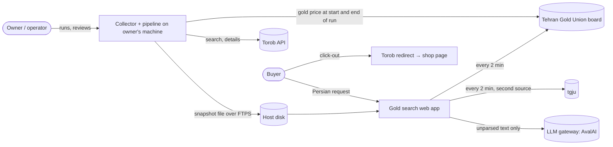

# Technical design document

| | |
| --- | --- |
| Status | draft (stage 03) |
| Version | 0.4 |
| Owner | Dariush Hadipour |
| Last updated | 2026-10-23 |
| Inputs | [PRD](../product/prd.md) v1.4; [data model](data-model.md); [API contract](api-contract.md); [IA and flows](../design/ia-user-flows.md); [eval plan](../qa/eval-plan.md); [decision records](adr/) |
| Standard | Google design-doc format; C4 model (levels 1–2); every significant choice has a decision record |

## 1. Context and scope

A Persian web app that turns a free-text request for gold jewelry into a ranked list of real-gold Torob products, with a price breakdown and resale estimate per shop offer (PRD §2). This document covers the collector, the data pipeline, the web app and its API, and the evaluation harness. It does not cover Torob's systems or any purchase flow.

## 2. Goals and non-goals

**Goals**
- Meet the PRD v1.4 rules (87 BRs, 84 of them in the MVP) and the quality metrics of PRD §4.1 on the test splits.
- Every number on screen traceable to its inputs and source (BR-46, D-14).
- Lowest running cost (D-11), runnable by one person.

**Non-goals**
- Server-side crawling, user accounts, payments, mobile apps, Torob ↔ Digikala matching (D-24), image understanding.

## 3. Constraints

| ID | Constraint | Evidence |
|---|---|---|
| TC-01 | Torob answers HTTP 490 (anti-bot) to traffic from some networks, and answers normally over a direct home connection | collector run logs 2026-10-21/22 (`data/raw/*/runs.jsonl`); [S-17] |
| TC-02 | Only `/v4/base-product/search` and `/details` are allowed for Torob's API | `docs/evidence/torob-robots-2026-10-21.txt` |
| TC-03 | Even on the direct connection, the details endpoint walls after ~40–120 requests at 12–25 s gaps and clears after ~30 min | `data/eval/fetch-details.log` (2026-10-22) |
| TC-04 | LLM only through an OpenAI-compatible gateway reachable from Iran. Hoosha's developer API is media-only, so AvalAI is the one candidate the owner named that fits | ADR-0005 |
| TC-05 | Lowest cost; collection runs on the owner's machine. A sleeping or offline machine skips runs: the 2026-10-22 evening run got only network errors | D-11; `data/raw/2026-10-22/runs.jsonl` |
| TC-06 | Rules first, LLM never produces numbers | D-09 |
| TC-07 | Persian, RTL, mobile first | PRD NFR-07, NFR-08 |
| TC-08 | The host plan has no backups, and its app filesystem is read-only apart from mounted disks | ADR-0004 |

## 4. System context (C4 level 1)

## 5. Containers (C4 level 2)

| ID | Container | Runs on | Technology | Responsibility | Decision record |
|---|---|---|---|---|---|
| K-01 | Collector | owner's machine, a scheduler twice a day | Node (TypeScript, no deps) | Gold price; all search pages; then up to 40 details pages in the BR-17 order (DM-10); gold price again. Stops on 490, non-JSON or network error (BR-12) | ADR-0002, ADR-0009 |
| K-02 | Pipeline | owner's machine, after K-01 | Node (TypeScript) + `node:sqlite` | All raw so far → snapshot: offers and merge (DM-08), extraction, labels, breakdown at the G of each fetch, history | ADR-0002, ADR-0003 |
| K-03 | Publisher | owner's machine, after K-02 | Node (TypeScript) | Upload `<run_id>.sqlite`, then `<run_id>.sha256` last, to the host disk over FTPS | ADR-0002, ADR-0004 |
| K-04 | Web app | Liara, Next.js platform | Next.js (App Router), React, TypeScript | UI (SC-01–SC-05), `/api/v1/*`, snapshot watcher | ADR-0001, ADR-0004 |
| K-05 | Search core | inside K-04 | TypeScript module | Rules parser (BR-50–BR-5A), representative offer (BR-84), filters and ranking (BR-60–BR-67), explanation (BR-70–BR-74) over the in-memory snapshot | ADR-0005, ADR-0006 |
| K-06 | Gold price service | inside K-04 | TypeScript, in-process timer | Fetch union **and** tgju every 2 min; pick G by BR-01–BR-03; flag BR-04; `market_open` by A-01 | ADR-0007 |
| K-07 | Events store | host disk | `node:sqlite`, append-only | Analytics events (tracking plan) | ADR-0003 |
| K-08 | Evaluation harness | repo, CI and the owner's machine | TypeScript scripts + fixtures | EV-* metrics with intervals; on release tags it writes the data of the static methodology page (SC-05, BR-122) | ADR-0008 |

The search core (K-05) is a plain module with no framework imports, so the pipeline, the API and the evaluation harness all call the same code.

## 6. Key flows

**F-1 Collect, derive, publish (twice a day)**
1. A scheduler starts K-01. It reads robots.txt and fetches the gold price.
2. It fetches all search pages with 10–15 s gaps (BR-11).
3. It fetches up to 40 details pages with 25 s gaps, in the BR-17 order.
4. It fetches the gold price again, so every offer has a quote within 60 min (DM-01).
5. Any 490, non-JSON answer or network error ends the run at once and is logged with its reason (BR-12). What was fetched so far is still used.
6. K-02 builds `snapshot-<run_id>.sqlite` from all raw files so far, so details from earlier runs are reused.
7. K-03 uploads the file and its checksum. The watcher in K-04 (§8) validates it and swaps the active snapshot atomically.
8. If any step fails, the previous snapshot stays active. After 48 h without a new one the app enters archive mode (BR-16).

**F-2 Search**
1. `POST /parse` while typing. Rules run first (< 50 ms). Only unparsed spans go to the LLM, with a JSON schema; numbers from the LLM must appear in the text (BR-55). A money amount with an ambiguous unit returns `ask` and blocks search until answered (BR-52).
2. `POST /search`:
   - `mode` from form chips; `non_jewelry` returns only the savings card (BR-57).
   - Product-level hard filters (BR-60).
   - Representative offer per product under offer-level filters; products without one drop out (BR-84).
   - Budget filter on that offer's price.
   - Bands for budget and weight targets (BR-52, BR-54); ojrat filters with the «اجرت قابل محاسبه نیست» bucket (BR-59).
   - Component scores by the PRD BR-62 formulas and intent weights.
   - Explanation for #1 vs #2 from computed fields; LLM text is optional and validated (BR-71).

**F-3 Detail and click-out**
`POST /products/{id}`, with the same chips and snapshot as the search, returns every eligible offer with its own fetch-time G (BR-48). Live fields (resale, required rise) use the current G. It also returns history (BR-90) and shop averages with n ≥ 5 (BR-91). `POST /events` records `offer_clicked` without personal data (BR-111). The click goes to the offer's Torob redirect URL, so Torob's own click accounting stays intact.

## 7. Data design

See [data-model.md](data-model.md): raw, snapshot (immutable SQLite per run) and live layers, with integrity rules DM-01–DM-10.

**Freshness, by design (BR-14, BR-17).**
- Every run refreshes the cheapest price of every product its queries return: 439–461 products per run, measured.
- Only 17.1–21.6% of cards name several shops. For the rest, the card is already the whole online offer list.
- Multi-shop products (~80–95 per run) compete for 80 details pages a day. So their other shops are refreshed about once a day, and some will carry the «قدیمی» label. [estimate]
- Each run logs the share of representative offers older than 24 h, which feeds the PRD freshness metric.

## 8. Interfaces

- Public: [api-contract.md](api-contract.md) (`/api/v1`).
- Internal: there is **no HTTP publish endpoint**. The snapshot watcher in K-04 checks `snapshots/` on the disk every 60 s. A new `<run_id>.sha256` triggers the checks:
  - the checksum matches;
  - `schema_version` is known;
  - `meta.finished_at` is newer than the active snapshot's.

  If all pass, the watcher swaps the in-memory snapshot and keeps the active file plus the 2 before it. A failed check leaves the active snapshot in place and is logged.

## 9. Cross-cutting concerns

| Concern | Design |
|---|---|
| Security | Listing titles are untrusted (BR-74). The parser LLM never sees titles. The explanation LLM gets only computed fields and titles inside a delimited data block, and its output is checked against the numbers (BR-71). Secrets live only in the host environment (LLM key) and the owner's local keychain (FTPS credentials). The rate limit per IP is in memory (API contract §2). Threats: [threat-model.md](threat-model.md). |
| Privacy | No accounts. No IP or user agent is stored with events. `session_id` is a tab-scoped random id (tracking plan). |
| Observability | `meta` table per snapshot; `GET /status` (snapshot age, gold-price age, archive mode) polled hourly for NFR-06; collector run log with stop reason and the stale-offer share. |
| Performance | The snapshot is loaded into memory at start and on swap. Search runs in-process over ~10³ products (NFR-01–NFR-03). The 0.5 GB RAM plan is measured at M4 (§14). |
| Accessibility | WCAG 2.2 AA (NFR-09); RTL; 360 px (NFR-08). |
| Resilience | Archive mode (BR-16); tgju fallback (BR-03); rules-only and template paths when the LLM fails (BR-73), including an international-internet cut-off (ADR-0005). |
| Backups | The plan has none (TC-08). Snapshots can be rebuilt from raw on the owner's machine. The owner pulls `events.sqlite` over FTPS weekly. |
| Cost (NFR-13) | About 810,000 toman a month: host 750,000 plus LLM ≈ 60,000, which the gateway's sign-up credit covers (ADR-0004, ADR-0005). About 525,000 toman for three weeks billed hourly. |

## 10. Testing approach

- Unit tests with `node:test`, at least one per BR (NFR-12), on a frozen fixture snapshot from `data/raw/2026-10-22`. Node runs TypeScript directly.
- Evaluation harness (K-08) computes EV-MAT, EV-EXT, EV-PRM and EV-QRY with Wilson or bootstrap intervals ([eval plan](../qa/eval-plan.md)); EV-RNK at M5 (D-25).
- End-to-end tests with Playwright for the main scenarios in [test-cases.md](../qa/test-cases.md).
- **CI on every push:** unit tests, plus the harness on the **tune** split. The job fails if a tune metric is lower than on `main`, unless the change cites a decision-log entry that accepts the trade-off.
- **Release tags only** (M4, M5, Gate 3): the harness scores the **test** split. The gate is the point estimate against the PRD target, and the 95% interval is published next to it. Eval plan §2 and §3 have the rules and the interval widths.

## 11. Deployment and environments

| Environment | What runs | Data |
|---|---|---|
| Local | `next dev`, pipeline scripts | fixture snapshot |
| Production | K-04 on Liara (ADR-0004): Zamin plan, 1 GB disk for snapshots and events, `*.liara.run` subdomain, `X-Robots-Tag: noindex` on every response, so the demo stays out of search results | published snapshots |

No staging environment: one operator, one app, and every snapshot can be tested locally before it is published.

## 12. Migration and versioning

- Snapshot `schema_version` starts at 1; the watcher refuses unknown versions (§8).
- `pipeline_version` changes when extraction or labelling rules change; the methodology page shows which version produced the numbers.
- API under `/api/v1`; breaking changes need `/api/v2` (API contract §7).

## 13. Alternatives considered

| Alternative | Why not |
|---|---|
| Crawl from the server | Torob walls tunnel traffic (TC-01) and the details endpoint walls quickly (TC-03); server egress costs money |
| HTTP publish endpoint with a bearer token | One more public write surface. The host already offers FTPS to the disk (ADR-0004) |
| Details for every product every run | ~450 details pages a run would hit the wall (TC-03); the card already holds the cheapest price |
| Managed Postgres | Data fits in memory; an immutable file per snapshot is simpler and cheaper (ADR-0003) |
| Python pipeline | One language across pipeline, API and evaluation (D-08) |
| Embeddings / vector search | ~10³ listings with structured attributes; filters and rules are measurable and explainable; revisit if EV-RNK shows a gap |
| Static site with client-side LLM calls | Would expose the LLM key and hit CORS on the gold-price sources |

## 14. Open questions

| Question | Owner | By |
|---|---|---|
| Does the 0.5 GB plan hold the app and snapshot? Measure RSS on the fixture; else the 1 GB plan | Builder | M4 |
| Do the host's prices include VAT? | Builder | before deploy |
| Does gpt-4.1-nano parse Persian well enough? EV-QRY tune split, rules-only vs rules+LLM | Builder | M5 |
| Meaning of Torob's `is_authentic` flag | Builder | M4 |

## 15. Decision records

| ID | Title | Status |
|---|---|---|
| [ADR-0001](adr/0001-typescript-nextjs.md) | TypeScript end to end, Next.js for the web app | proposed |
| [ADR-0002](adr/0002-collect-on-owner-machine.md) | Collect and derive on the owner's machine, publish snapshots | proposed |
| [ADR-0003](adr/0003-sqlite-snapshots.md) | Immutable SQLite snapshot per run; SQLite events log | proposed |
| [ADR-0004](adr/0004-hosting.md) | Host on Liara (Zamin plan), snapshots on its disk | proposed |
| [ADR-0005](adr/0005-llm-gateway.md) | LLM through AvalAI, gpt-4.1-nano, rules-only fallback | proposed |
| [ADR-0006](adr/0006-rules-first-parser.md) | Rules-first parser with schema-bound LLM fallback | proposed |
| [ADR-0007](adr/0007-gold-price-sources.md) | Union board primary, tgju fallback, G stored per fetch | proposed |
| [ADR-0008](adr/0008-eval-harness-in-ci.md) | Evaluation harness in CI with metric gates | proposed |
| [ADR-0009](adr/0009-crawl-politeness.md) | Collector politeness: allowed paths, pacing, stop on 490 | proposed |
| [ADR-0010](adr/0010-plain-node-demo.md) | Plain Node HTTP server for the first demo (D-34) | accepted |

## Revision history

| Version | Date | Change |
|---|---|---|
| 0.1 | 2026-10-23 | First draft for stage 03 |
| 0.2 | 2026-10-23 | Technical review (D-28): representative offer and details queue in flows; no HTTP publish endpoint (FTPS + watcher); both gold sources every refresh; network stop; CI tune vs release test rules; freshness by design; host and LLM chosen (ADR-0004, ADR-0005); cost; backups |
| 0.3 | 2026-10-23 | Freeze readiness: PRD v1.2 (86 BRs); event renamed to `offer_clicked`; the reason for noindex stated |
| 0.4 | 2026-10-23 | Independent review: product detail is `POST /products/{id}` with chips; `GET /status` replaces `/healthz`; methodology page built by K-08 at release; PRD v1.3 |
